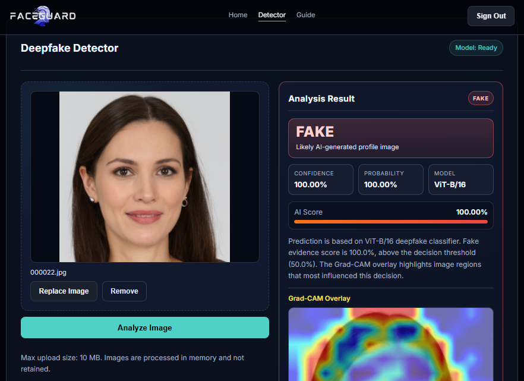

# FaceGuard Evidence

FaceGuard Evidence is a personal, evidence-grounded multimodal
retrieval-augmented generation (RAG) project by Tan Yan Yi.

The planned system will upgrade the complete original FaceGuard website with
an evidence-grounded RAG workflow. It will retain the website's image
analysis, authentication, profile and history capabilities while adding file
metadata, versioned model documentation, measured evaluation evidence,
authoritative research and media-verification guidance.

> **Project status:** Phase 0 provenance and reproducibility audit. The RAG
> implementation has not started.

## Why This Project Exists

A detector probability is not proof that an image is real or AI-generated. It
also cannot establish who created an image, which tool created it or whether
there was deceptive intent.

FaceGuard Evidence is intended to place detector output inside a traceable
evidence workflow:

```text
Uploaded still image
        |
        +--> Observable file and image metadata
        |
        +--> Versioned FaceGuard detector adapter
        |
        +--> Retrieval from an approved evidence collection
        |
        +--> Cited response with explicit claim boundaries
```

The user may provide a focused question about the uploaded image. When no
question is supplied, the system will generate a default evidence report.

## Planned Response Structure

Responses will distinguish:

1. **Observed facts** - directly measurable file or image properties.
2. **Detector output** - model version, probability, threshold and latency.
3. **Retrieved evidence** - cited passages relevant to the result.
4. **Supported conclusions** - claims justified by the available evidence.
5. **Unsupported conclusions** - identity, authorship, intent or certainty
   claims that the system cannot establish.
6. **Verification steps** - practical actions for further investigation.

## First-Release Scope

The initial release is limited to:

- one unified FaceGuard website;
- the existing authentication, profile and analysis-history capabilities;
- still-image uploads;
- one existing FaceGuard ViT-B/16 detector checkpoint;
- relevant image and file metadata;
- structure-aware evidence ingestion and chunking;
- PostgreSQL full-text retrieval;
- pgvector semantic retrieval;
- hybrid retrieval fusion;
- a reranking experiment;
- cited, evidence-bounded generation;
- separate retrieval and generation evaluation; and
- latency, token-usage and Azure-cost measurement.

## Non-Goals

The initial release will not include:

- video or audio analysis;
- facial recognition or identity inference;
- attribution to a specific generator or person;
- intent or criminality inference;
- automatic moderation, enforcement or publication decisions;
- multiple cooperating agents;
- Kubernetes or blockchain; or
- unsupported or estimated model-performance claims.

## Relationship to the Original FaceGuard Project

The original detector was developed collectively by the MCS24 Team at Monash
University Malaysia:

<https://github.com/MCS24-Team/FaceGuard-AI-Detector-MVP>

It remains separately attributed team work. The original repository's full Git
history will be preserved when its website is integrated into this private
repository, retaining the original authors and commits rather than copying the
files into a fresh commit.

Tan's new RAG work will be added after that preserved history. Detector access
will still use a small, versioned adapter so the model remains replaceable and
auditable. The selected checkpoint is stored outside Git and identified by its
SHA-256 checksum.

See:

- [`ATTRIBUTION.md`](ATTRIBUTION.md)
- [`THIRD_PARTY_NOTICES.md`](THIRD_PARTY_NOTICES.md)
- [`docs/MODEL_CARD.md`](docs/MODEL_CARD.md)

## Evidence and Reproducibility

Evidence sources are not accepted merely because they are publicly accessible.
Each source must have a recorded identity, version, owner, permitted-use basis
and retrieval status.

Historical metrics from the original training notebook are documented as
historical evidence. They are not presented as independently reproduced
FaceGuard Evidence results.

See:

- [`docs/DATA_SOURCE_REGISTER.md`](docs/DATA_SOURCE_REGISTER.md)
- [`docs/EXPERIMENTS.md`](docs/EXPERIMENTS.md)
- [`docs/LEARNING_LOG.md`](docs/LEARNING_LOG.md)

## Data and Artifact Policy

This repository must not contain:

- restricted datasets or annotations;
- uploaded user images;
- secrets or private environment files;
- model checkpoints without verified redistribution permission; or
- copied third-party training code with unresolved licensing.

The repository will commit an `.env.example` when runtime configuration is
introduced, while real secrets remain in local `.env` files.

## Current Work

Phase 0 establishes:

- collective and individual attribution;
- third-party provenance;
- exact detector artifact identity;
- known reproducibility gaps;
- source-acceptance rules; and
- experiment-recording standards.

Implementation will begin only after this foundation is reviewed.

---

## Original FaceGuard Website Baseline

The following baseline documentation is preserved from the imported MCS24 Team
repository. It describes the original website before the FaceGuard Evidence
RAG extension.

Claims in this baseline section are part of the original project description.
They are not independently verified FaceGuard Evidence measurements.

<p align="center">
  
</p>

MCS24 Team is dedicated to develop **FaceGuard: a Privacy-Preserving AI for Detecting Deepfake Profile Photos**, a user-friendly web-based system to accurately identify and classify AI-generated human face images on social media and dating platforms. **FaceGuard** is anticipated to deliver a fully functional web-based system with visual explainability via Grad-CAM heatmaps that can accurately classify profile photos as real or AI-generated.

> **INTELLECTUAL PROPERTY NOTICE:**
>
> **FaceGuard** and all original materials in this repository (including source code, UI design, documentation, model integration logic and project artifacts) are intellectual property of the **MCS24 Team** unless otherwise stated.
>
> **Copyright © 2025/26 MCS24 Team. All rights reserved.**
>
> Third-party components, datasets and model weights remain the property of their respective owners and are subject to their original licenses and terms. Refer to [THIRD_PARTY_NOTICES.md](models/THIRD_PARTY_NOTICES.md) for attribution details.
> 
> If you reference this project in reports, demos or derivative works, please credit it as:
> ```
> FaceGuard: a Privacy-Preserving AI for Detecting Deepfake Profile Photos, MCS24 Team, 2026.
> ```
>
> **DISCLAIMER:** This project is for educational and research purposes only. It is not intended for commercial use and is not endorsed by any organization or entity. Use at your own risk.

## Project Overview

The FaceGuard MVP provides:

- Web-based image upload and preview workflow
- Backend inference API for binary REAL/FAKE classification
- Confidence score and model metadata in responses
- In-memory processing with no database persistence
- Account authentication and authorisation
- Explainability overlays (Grad-CAM heatmaps)



## Repository Structure

```text
FaceGuard-AI-Detector/
├── config/
│   └── settings.py
│
├── dev/
│   ├── backend/
│   └── frontend/
│
├── docs/
│   ├── design/
│   ├── diagrams/
│   └── documents/
│
└── models/
  ├── pretrained/
  │   ├── vit.pth
  │   ├── xception.pth
  │   └── pg_fdd.pth
  │
  ├── README.md
  └── THIRD_PARTY_NOTICES.md
```

## Prerequisites

- Python 3.9+
- Node.js 18+
- npm 9+
- A compatible model checkpoint file (eg. `models/pretrained/vit.pth`)

## Quick Start

### 1. Install Python dependencies

From the repository root:

```bash
python -m venv .venv
```

Activate the virtual environment:

```bash
# Windows
.venv\Scripts\activate

# macOS/Linux
source .venv/bin/activate
```

Install backend dependencies:

```bash
pip install -r requirements.txt
```

### 2. Install frontend dependencies

```bash
cd dev/frontend
npm install
```

### 3. Start backend

In a terminal from the repository root:

```bash
cd dev/backend
python -m uvicorn app.main:app --reload --host 127.0.0.1 --port 8001
```

### 4. Start frontend

In a second terminal:

```bash
cd dev/frontend
npm run dev
```

Open the application at:

- `http://localhost:5173`

## Health Endpoint

Verify backend readiness:

- `GET http://127.0.0.1:8001/api/health`

Example response:

```json
{
  "status": "ok",
  "model_ready": true,
  "model_name": "vit"
}
```

If `model_ready` is `false`, the backend is reachable but the configured
checkpoint file is missing or failed to load.

## API Contract

### GET /api/health

Returns service and model availability status.

### POST /api/analyze

Accepts `multipart/form-data` with field:

- `file` (JPEG, PNG, or WebP)

Example response:

```json
{
  "label": "FAKE",
  "confidence": 0.9123,
  "fake_probability": 0.9123,
  "threshold": 0.5,
  "explanation": "Prediction is based on a ViT deepfake classifier...",
  "model_name": "vit",
  "heatmap_overlay": "data:image/png;base64,...",
  "explainability_method": "grad_cam"
}
```

## Model Checkpoints

The backend loads model checkpoints from a local path or from Hugging Face Hub
based on environment variables and `config/settings.py`.

Common checkpoint names:

- `vit.pth`
- `vit3.pth`
- `xception.pth`
- `pg_fdd.pth`

Large model binaries are excluded from source control. Keep checkpoints in local
or approved storage and distribute them according to license terms.

### Hugging Face Hub on Render

For deployment, upload the checkpoint to a Hugging Face model repository and set
these Render backend environment variables:

```text
HF_MODEL_REPO=your-username/faceguard-vit3
HF_MODEL_FILE=vit3.pth
HF_TOKEN=your_hugging_face_read_token
MODEL_CACHE_DIR=/tmp/faceguard_models
FACEGUARD_MODEL_NAME=vit
FACEGUARD_FRONTEND_ORIGINS=https://your-vercel-app.vercel.app
```

If you want to keep local development using a file on disk, set:

```text
FACEGUARD_MODEL_PATH=models/baseline/vit3.pth
```

## Design and Project Artifacts

Supporting design and project materials are available in:

- `docs/design/`
- `docs/diagrams/`
- `docs/documents/`

## Additional Documentation

For development operations and troubleshooting guidance, refer to [**Developer Guide**](DEVELOPER_GUIDE.md).
